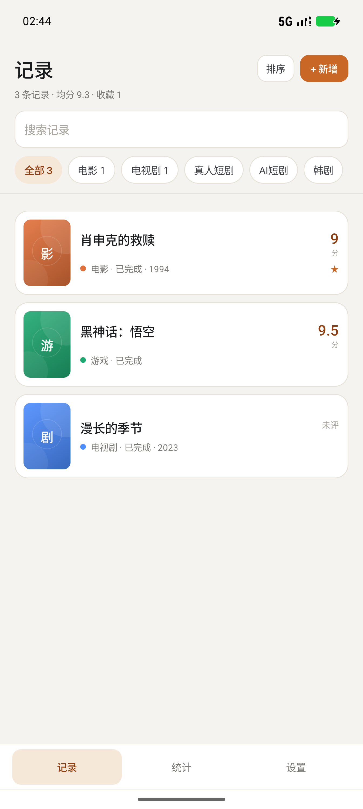
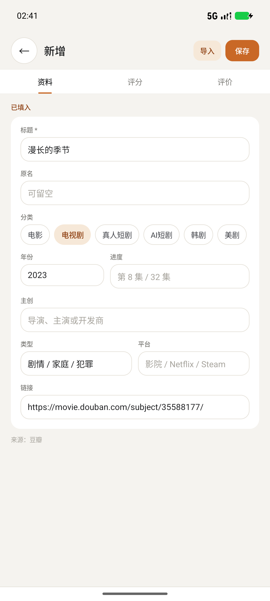
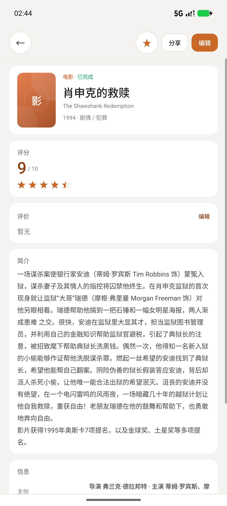
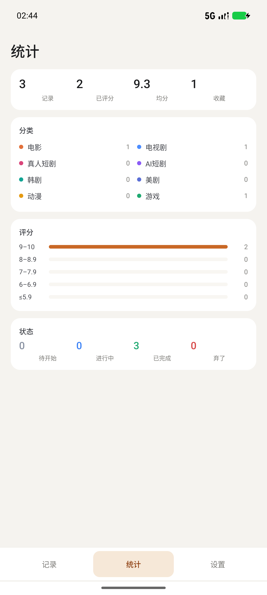
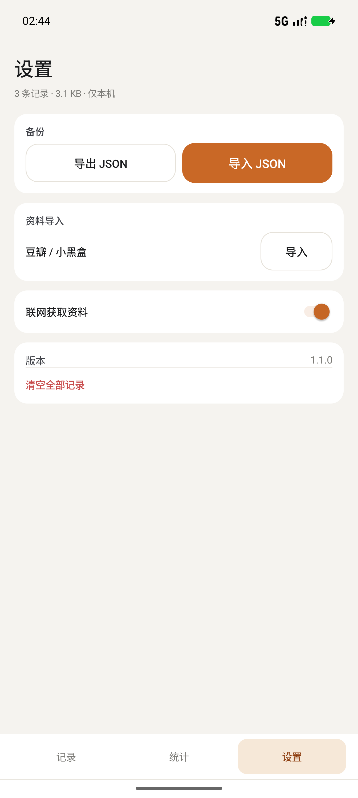

# 片刻

本地优先的 Android 作品记录与评分应用。支持电影、电视剧、真人短剧、AI 短剧、韩剧、美剧、动漫、游戏。

- APK：[`dist/Pianji-1.1.0.apk`](dist/Pianji-1.1.0.apk)
- 版本：1.1.0（versionCode 2），约 64.7 KB
- 系统：Android 7.0+（minSdk 24，targetSdk 34）
- SHA-256：`B0EDE6DCE047239F0C2736C6D4189D3A3B99C1BC3E5F1DE4F95A1359894EA7D1`
- 校验文件：[`dist/SHA256SUMS.txt`](dist/SHA256SUMS.txt)

## 1.1.0 更新

- 移除了品牌口号、英文小标题、说明性段落、诗句式空状态等装饰文案。
- 移除了首页大标题卡、统计页的“看看你的口味”、设置页的“本地收藏家”等描述性标题。
- 首页改为固定工具栏/搜索/分类筛选，只有记录列表滚动。
- 统计页改为单屏仪表盘，无纵向滚动。
- 设置页改为单屏布局，无纵向滚动。
- 新增/编辑页拆分为「资料 / 评分 / 评价」三个页签；每个页签在当前屏幕上完整显示，不再是一条长表单。
- 详情页移除页标题和重复状态，只保留固定操作栏与内容区。
- 数据格式不变，可直接覆盖安装 1.0.0，原记录保留。

## 功能

- 8 类记录：电影、电视剧、真人短剧、AI 短剧、韩剧、美剧、动漫、游戏
- 十分制评分，0.1 分步进，0 表示未评分
- 状态：待开始、进行中、已完成、弃了
- 收藏、年份、进度、主创、类型、平台、链接、评价、简介
- 搜索、分类筛选，按最近更新 / 评分 / 标题排序
- 单屏统计：记录数、已评分数、均分、收藏、分类计数、评分分布、状态计数
- 豆瓣链接导入、分享内容导入、小黑盒分享文案识别
- JSON 备份导出/导入，支持换机迁移与覆盖恢复
- 记录保存在应用私有目录，使用原子文件写入；无账号、无广告、无云同步

## 安装

1. 把 `Pianji-1.1.0.apk` 复制到手机。
2. 点击安装；系统提示未知来源或 Play Protect 时选择继续安装。
3. 已安装 1.0.0 的同一签名版本可直接覆盖升级，不需要清除数据。

自签名密钥保存在 `keystore/pianji-release.jks`，别名 `pianji`，密码 `pianji-local-2026`。后续自行构建升级必须继续使用该密钥。

## 平台导入

- **豆瓣**：粘贴 `https://movie.douban.com/subject/.../` 链接，或从豆瓣分享到「片刻」。读取公开手机版页面和公开元数据，填充标题、年份、类型、简介、电影主创等。
- **小黑盒**：使用小黑盒分享到「片刻」，或粘贴带【作品名】与“我打了 x 分”的分享文案。小黑盒直链会受其风控影响，失败时改用分享文案或手动填写。
- 导入只补全作品资料，不读取账号评分、豆列或观看历史；平台公开评分不会被当作你的评分。
- 导入链接会联网；可在「设置」关闭「联网获取资料」。

## 数据迁移

1. 旧手机：「设置」→「导出 JSON」。
2. 新手机安装同版本或更新版本：「设置」→「导入 JSON」。
3. 选择「合并」或「覆盖」。

备份包含全部作品字段、评分、评价、收藏、来源和链接。卸载应用会删除本地数据，操作前请先导出。

## 数据与权限

- 数据文件：应用私有目录 `files/records.json`。
- 关闭 Android 云自动备份（`allowBackup=false`）。
- `INTERNET` 与 `ACCESS_NETWORK_STATE` 权限只用于主动导入平台链接。
- 无登录、无分析 SDK、无广告。

## 构建

环境：

- Windows
- Android Studio JBR：`C:\Program Files\Android\Android Studio\jbr`
- Android SDK：platform `android-34`，Build-Tools `34.0.0` 与 `36.1.0`
- 无需 Gradle、AndroidX 或第三方依赖

执行：

```powershell
powershell -NoProfile -ExecutionPolicy Bypass -File .\build.ps1
```

输出 `dist/Pianji-1.1.0.apk`，并自动执行签名、签名校验和 zipalign 校验。

## 项目结构

```text
app/src/main/AndroidManifest.xml
app/src/main/java/com/dsh/pianji/
  MainActivity.java        记录列表、统计、设置
  EditActivity.java        资料/评分/评价三页签编辑器
  DetailActivity.java      详情
  Store.java               本地原子 JSON 存储
  BackupManager.java       JSON 备份读写
  PlatformImporter.java    豆瓣/小黑盒/网页与分享文案解析
  Item.java                数据模型
  Cat.java / Status.java   分类与状态
  Ui.java                  原生界面工具
  PosterView.java          分类色块
  StarRowView.java         半星评分
  HBarView.java            统计条
  Prefs.java               导入联网开关与排序偏好
app/src/main/res/          图标、主题、颜色
build.ps1                  零依赖构建脚本
dist/                      签名 APK 与 SHA-256
docs/                      界面截图
```

## 已知限制

- 不提供云同步，跨手机迁移依赖手动导出/导入。
- 不导入豆瓣/小黑盒账号中的个人历史或账号评分。
- 不下载海报；使用分类色块。
- 平台页面结构变化可能导致导入失败，可粘贴分享文案或手动填写。
- 自签名 APK 可能触发系统的未知来源提示。

## 验证

在 Android 模拟器（API 37，1344×2992）完成：

- 1.1.0 覆盖安装 1.0.0，3 条记录保留
- 首页 / 新增记录 / 豆瓣分享链接导入 / 编辑保存 / 详情
- 统计页无纵向滚动节点
- 设置页无纵向滚动节点
- 编辑器三个页签无纵向滚动节点，字段完整显示
- 导出文件选择器可正常打开
- APK Signature Scheme v2 / v3 签名校验通过

## 截图










